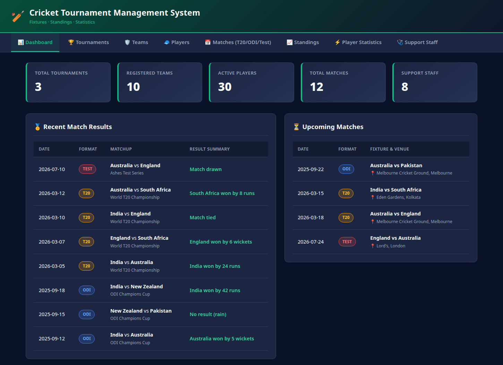
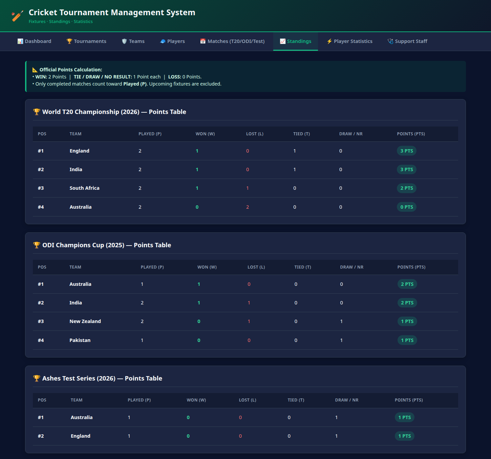
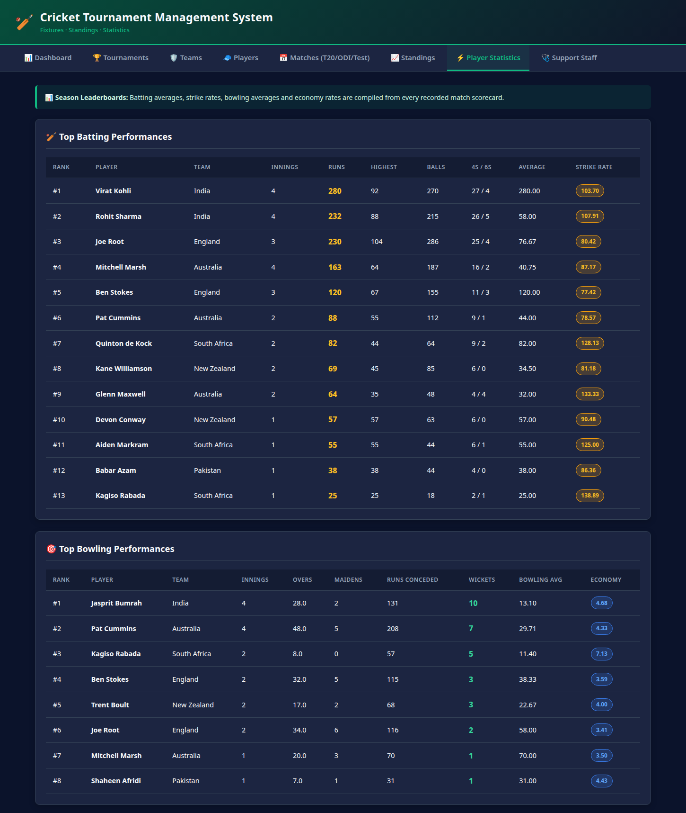
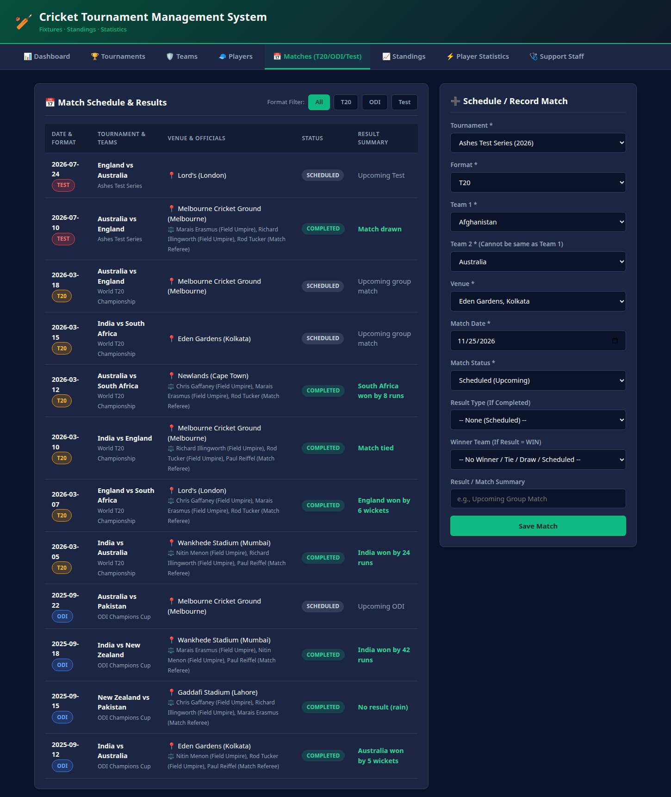
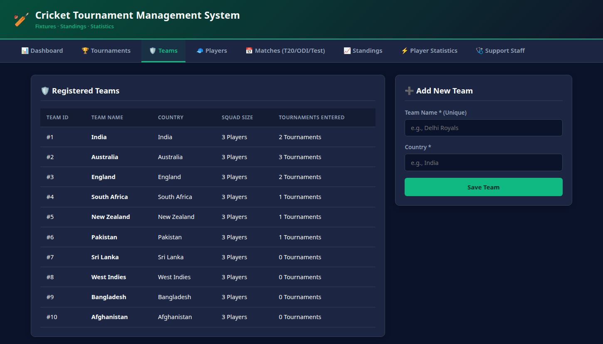

# Cricket Tournament Management System

A full-stack cricket tournament management application built with **raw PHP 8** and **MySQL 8** — no framework, no Composer, no build tools. Front controller with a small MVC layer: repositories own the SQL, controllers handle validation, views render plain HTML.



---

## Table of Contents

- [Features](#features)
- [Screenshots](#screenshots)
- [Tech Stack](#tech-stack)
- [Project Structure](#project-structure)
- [Database](#database)
- [Running on Windows — Easiest Way (WampServer)](#running-on-windows--easiest-way-wampserver)
- [Running on Windows — Alternative (XAMPP)](#running-on-windows--alternative-xampp)
- [Running on Windows — Standalone PHP (no Apache)](#running-on-windows--standalone-php-no-apache)
- [Running on Linux / macOS](#running-on-linux--macos)
- [Configuration](#configuration)
- [Routes](#routes)
- [Resetting the Database](#resetting-the-database)
- [Troubleshooting](#troubleshooting)

---

## Features

- **Dashboard** — live row counts for tournaments, teams, players, matches and staff, plus recent results and upcoming fixtures.
- **Full CRUD** — add teams, players, tournaments, matches and support staff through validated forms.
- **Match format filter** — one click to filter the fixture list by `T20`, `ODI`, `Test` or `All`.
- **Live points tables** — standings aggregated in SQL from completed matches only:
  `WIN = 2` points, `TIE / DRAW / NO_RESULT = 1` point, `LOSS = 0`. Scheduled matches never count.
- **Player leaderboards** — batting average, strike rate, bowling average and economy calculated live from the scorecard tables.
- **Match officials** — every fixture shows its assigned umpires and match referee.
- **Security hardening**
  - PDO prepared statements everywhere (no string-built SQL).
  - CSRF token on every form (requests without a valid token are rejected with `419`).
  - Post/Redirect/Get pattern — refreshing after a save never resubmits the form.
  - All output escaped with `htmlspecialchars` via the `e()` helper.

---

## Screenshots

| Standings | Player Statistics |
|---|---|
|  |  |

| Matches (with format filter) | Teams |
|---|---|
|  |  |

---

## Tech Stack

| Layer | Technology |
|---|---|
| Language | PHP 8.1+ (typed properties, strict types) |
| Database | MySQL 8.x (InnoDB, `utf8mb4`) — MariaDB also works |
| Data access | PDO with exception mode, native prepares |
| Front end | Plain HTML5 + vanilla CSS (dark theme), no JS framework |
| Server | Any: Apache, Nginx, or PHP's built-in development server |

---

## Project Structure

```
cricket_project/
├── app/
│   ├── autoload.php              # PSR-4 autoloader + e() / url() helpers
│   ├── Controllers/              # 8 controllers, one per page
│   │   ├── DashboardController.php
│   │   ├── MatchController.php
│   │   ├── PlayerController.php
│   │   ├── StaffController.php
│   │   ├── StandingsController.php
│   │   ├── StatsController.php
│   │   ├── TeamController.php
│   │   └── TournamentController.php
│   ├── Core/                     # framework-lite pieces
│   │   ├── Controller.php        # view rendering + redirect helper
│   │   ├── Csrf.php              # session-based form tokens
│   │   ├── Database.php          # PDO singleton
│   │   └── Flash.php             # one-shot redirect messages
│   └── Repositories/             # ALL SQL lives here
│       ├── MatchRepository.php
│       ├── PlayerRepository.php
│       ├── StaffRepository.php
│       ├── StatsRepository.php   # counts, standings, leaderboards
│       ├── TeamRepository.php
│       └── TournamentRepository.php
├── config/
│   └── config.php                # DB credentials (env-overridable)
├── public/                       # web root — point the server here
│   ├── index.php                 # front controller (routing)
│   ├── .htaccess
│   └── assets/css/style.css
├── sql/
│   ├── schema.sql                # CREATE DATABASE + 12 tables
│   └── seed.sql                  # sample data (truncates first)
├── views/                        # PHP templates
│   ├── layout.php                # page shell: header, nav, flashes
│   ├── partials/flash.php
│   └── dashboard.php, tournaments.php, teams.php, players.php,
│       matches.php, standings.php, stats.php, staff.php
└── docs/screenshots/             # images used in this README
```

---

## Database

`sql/schema.sql` creates the `cricket_tournament` database with **12 tables**:

| Table | Purpose |
|---|---|
| `teams` | Franchise/national teams (name is unique) |
| `players` | Player profiles: DOB, batting and bowling style |
| `teamplayers` | Squad membership; open contract while `end_date IS NULL` |
| `tournaments` | Tournaments with season and date range |
| `tournamentteams` | Which teams are registered in which tournament |
| `venues` | Stadiums and cities |
| `umpires` | Umpire registry |
| `matches` | Fixtures and results, with format/status/result enums |
| `matchofficials` | Umpires + roles assigned per match |
| `support_staff` | Coaches, physios, analysts (optionally team-linked) |
| `battingscorecard` | One row per batter per match |
| `bowlingscorecard` | One row per bowler per match |

Constraints are enforced in the schema: foreign keys, unique keys, `CHECK (team1_id <> team2_id)`, `CHECK (result_type <> 'WIN' OR winner_team_id IS NOT NULL)`, and `CHECK (end_date >= start_date)`.

`sql/seed.sql` loads a complete demo dataset: 10 teams, 30 players, 3 tournaments (T20, ODI and Test), 12 matches (8 completed, 4 scheduled), scorecards, officials and support staff — so every page has data the moment you open it.

---

## Running on Windows — Easiest Way (WampServer)

**Recommended route.** WampServer installs Apache, MySQL and PHP in a single package with a simple system-tray menu. The database driver this project needs (`pdo_mysql`) is enabled by default — no `php.ini` editing, no separate MySQL install, and phpMyAdmin is built in. One installer, three clicks, done.

### 1. Install WampServer

1. Download the 64-bit installer from the official site: <https://wampserver.aviatechno.net/>
2. Run it with default options (installs to `C:\wamp64`). If the installer offers to add missing **Visual C++ Redistributable** packages, accept — WampServer needs them.
3. After setup, start **WampServer** from the Start menu. Its tray icon (near the clock) turns **green**, which means Apache and MySQL are running.
   - Red or orange icon → a service failed to start (usually a port conflict) → see [Troubleshooting](#troubleshooting).

### 2. Copy the project into the web root

Copy the whole project folder to:

```
C:\wamp64\www\cricket_project
```

### 3. Create the database and load the sample data

1. Open <http://localhost/phpmyadmin> in your browser.
2. Open the **Databases** tab, enter the name `cricket_tournament`, press **Create**.
3. Select that database on the left, open the **Import** tab.
4. Choose file `C:\wamp64\www\cricket_project\sql\schema.sql` → press **Go**.
5. Repeat the import for `sql\seed.sql`.

Prefer the command line? Use the MySQL bundled with WampServer (the `mysql8.x.x` folder name matches your installed version — check `C:\wamp64\bin\mysql\`):

```bat
C:\wamp64\bin\mysql\mysql8.x.x\bin\mysql.exe -u root < sql\schema.sql
C:\wamp64\bin\mysql\mysql8.x.x\bin\mysql.exe -u root < sql\seed.sql
```

### 4. Database password

WampServer's `root` user has **no password** by default, and the project default matches it — nothing to change. If you set a password, open `config\config.php` and put it here:

```php
'password' => 'your_mysql_password',
```

(or set the `DB_PASSWORD` environment variable).

### 5. Pick a PHP version (8.1 or newer)

Left-click the tray icon → **PHP** → select a version **8.1 or newer**. The tray menu also shows which version is active. `pdo_mysql` is already enabled in every modern WampServer build.

### 6. Open the application

```
http://localhost/cricket_project/public/
```

The `public/` segment is required — it is the web root (everything outside `public/` stays unreachable via HTTP). Bookmarks, CSS, forms and redirects all work relative to that URL.

You should see the dashboard with the seeded data:


### 7. Stop the servers

Left-click the tray icon → **Exit** (stops everything), or stop Apache / MySQL individually from the same menu.

---

## Running on Windows — Alternative (XAMPP)

Same idea as WampServer, different control panel — use it if XAMPP is what you already have.

### 1. Install XAMPP

Download the Windows installer from <https://www.apachefriends.org/> and run it with default options. Install to `C:\xampp` (default).

### 2. Start Apache and MySQL

Open the **XAMPP Control Panel**, then click **Start** next to:

- **Apache** (the web server)
- **MySQL** (the database)

Both should turn green.

### 3. Copy the project into the web root

Copy the whole project folder to:

```
C:\xampp\htdocs\cricket_project
```

### 4. Create the database and load the sample data

1. Open <http://localhost/phpmyadmin> in your browser.
2. Click **New** on the left, enter database name `cricket_tournament`, press **Create**.
3. Select that database, open the **Import** tab.
4. Choose file `C:\xampp\htdocs\cricket_project\sql\schema.sql` → press **Go**.
5. Repeat the import for `sql\seed.sql`.

Prefer the command line instead? Use the MySQL that ships with XAMPP:

```bat
C:\xampp\mysql\bin\mysql.exe -u root < sql\schema.sql
C:\xampp\mysql\bin\mysql.exe -u root < sql\seed.sql
```

### 5. Set the database password (only if you have one)

XAMPP's `root` user has **no password** by default, and the project default matches that — nothing to change. If you set a MySQL password, open `config\config.php` and put it here:

```php
'password' => 'your_mysql_password',
```

(or set the `DB_PASSWORD` environment variable).

### 6. Open the application

```
http://localhost/cricket_project/public/
```

The `public/` segment is required — it is the web root (everything outside `public/` stays unreachable via HTTP). Bookmarks, CSS, forms and redirects all work relative to that URL.

### 7. Stop the servers

When finished, click **Stop** on Apache and MySQL in the XAMPP Control Panel.

---

## Running on Windows — Standalone PHP (no Apache)

Use this if you want the zero-dependency route: PHP's built-in server plus any MySQL install.

### 1. Install PHP

1. Download a **PHP 8.x zip build** for Windows from <https://windows.php.net/download/> (e.g. *VS16 x64 Thread Safe*).
2. Extract it to `C:\php`.
3. Inside `C:\php`, copy `php.ini-development` to `php.ini`.
4. Open `php.ini` in a text editor and enable the MySQL driver by removing the semicolon:

   ```ini
   extension=pdo_mysql
   ```

   (If your `php.ini` also lists `extension=mysqlnd`, enable it too.)
5. Add `C:\php` to your system `PATH` so `php` works in any terminal:
   - Win+R → `sysdm.cpl` → **Advanced** → **Environment Variables**
   - Under *System variables*, select `Path` → **Edit** → **New** → `C:\php`

Verify in a new terminal:

```bat
php -v
php -m | findstr pdo_mysql
```

The second command must print `pdo_mysql`.

### 2. Install MySQL

Easiest: the **MySQL Installer** from <https://dev.mysql.com/downloads/installer/>. Run it, choose *Developer Default* or *Server only*, remember the `root` password you set (or leave it empty), and finish the setup.

### 3. Load the schema

Open **Command Prompt** in the project folder:

```bat
cd C:\path\to\cricket_project
mysql -u root -p < sql\schema.sql
mysql -u root -p < sql\seed.sql
```

### 4. Start the application

```bat
php -S 127.0.0.1:8080 -t public
```

### 5. Open the browser

```
http://127.0.0.1:8080
```

Stop the server with `Ctrl+C`.

> Note: the built-in server is for development. For anything public, put the project behind Apache or Nginx with `public/` as the document root.

---

## Running on Linux / macOS

Install PHP with the MySQL driver and a MySQL/MariaDB server:

```bash
# Fedora / RHEL
sudo dnf install php php-pdo php-mysqlnd mysql-server

# Debian / Ubuntu
sudo apt install php php-mysql mysql-server
```

Load the database and start the dev server:

```bash
mysql -u root -p < sql/schema.sql
mysql -u root -p < sql/seed.sql

php -S 127.0.0.1:8080 -t public
```

Then open <http://127.0.0.1:8080>.

---

## Configuration

All settings live in `config/config.php` and can be overridden with environment variables:

| Variable | Default | Meaning |
|---|---|---|
| `DB_HOST` | `localhost` | MySQL host |
| `DB_USER` | `root` | MySQL user |
| `DB_PASSWORD` | *(empty)* | MySQL password |
| `DB_NAME` | `cricket_tournament` | Database name |
| `APP_DEBUG` | `1` | `1` shows stack traces on errors, `0` hides them |

Example (PowerShell):

```powershell
$env:DB_PASSWORD = "secret"; php -S 127.0.0.1:8080 -t public
```

Example (bash):

```bash
DB_PASSWORD=secret php -S 127.0.0.1:8080 -t public
```

---

## Routes

Every request goes through `public/index.php`.

**Pages (GET):**

| URL | Page |
|---|---|
| `index.php?page=dashboard` | Dashboard (default) |
| `index.php?page=tournaments` | Tournaments |
| `index.php?page=teams` | Teams |
| `index.php?page=players` | Players |
| `index.php?page=matches` | Matches (`&format=T20\|ODI\|Test` to filter) |
| `index.php?page=standings` | Points tables |
| `index.php?page=stats` | Batting / bowling leaderboards |
| `index.php?page=staff` | Support staff |

**Form actions (POST)** — dispatched from the hidden `action` field, always followed by a redirect:

| `action` value | Effect |
|---|---|
| `team.create` | Insert a team (rejects duplicates) |
| `player.create` | Insert a player, optionally link to a team |
| `tournament.create` | Insert a tournament and register selected teams |
| `match.create` | Insert a fixture with full result validation |
| `staff.create` | Insert a support staff member |

---

## Resetting the Database

Re-running the seed wipes current rows and reloads the sample data:

```bash
mysql -u root -p < sql/seed.sql
```

From scratch (drops nothing, recreates tables):

```bash
mysql -u root -p < sql/schema.sql
mysql -u root -p < sql/seed.sql
```

---

## Troubleshooting

| Symptom | Fix |
|---|---|
| `Could not find driver` (PDO) | PHP cannot find the MySQL driver. Windows: set `extension=pdo_mysql` in `php.ini` and restart the server. Linux: install `php-pdo php-mysqlnd` (Fedora) or `php-mysql` (Debian/Ubuntu). |
| `Class "PDO" not found` | PHP lacks the core PDO extension. Fedora/RHEL: `sudo dnf install php-pdo php-mysqlnd`. Debian/Ubuntu: `sudo apt install php-cli php-mysql`. Then restart the PHP server. |
| `Access denied for user 'root'` | Wrong password. Set it in `config/config.php` or export `DB_PASSWORD`. WampServer and XAMPP both default to an empty password. |
| WampServer tray icon stays red/orange | Apache or MySQL failed to start — usually port 80 already taken (IIS, Skype, another web server). Left-click tray icon → **Apache** → **Port used by Apache** → pick another port, or stop the conflicting program. |
| `419 — Invalid or expired form token` | The CSRF token did not match. Reload the form page and submit again; never replay a copied POST request. |
| Blank page or `Class ... not found` | The server must use `public/` as web root. Check you opened `/public/` (WampServer or XAMPP) or started `php -S ... -t public`. |
| `Address already in use` | Port 8000 (or 80) is taken — pick any free port: `php -S 127.0.0.1:8100 -t public`. |
| Error page with stack trace | You are in debug mode (`APP_DEBUG=1`). Set `APP_DEBUG=0` to hide traces in production. |
| Tables missing / stale data | Re-import `sql/schema.sql`, then `sql/seed.sql`. The seed truncates and reloads everything. |
| Old data from testing | Reset with `mysql -u root -p < sql/seed.sql`. |
